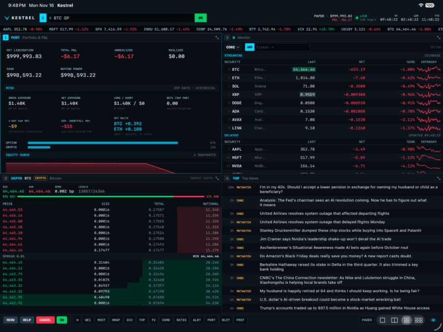
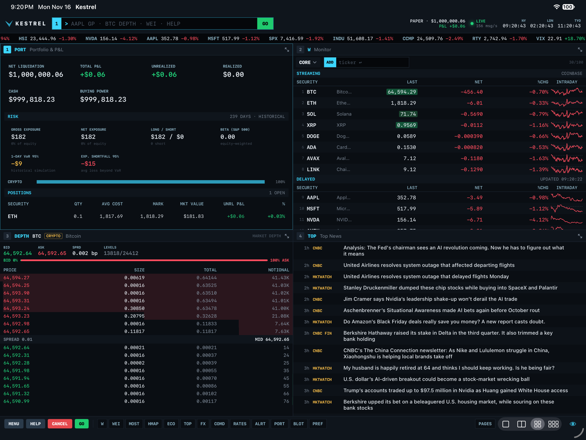
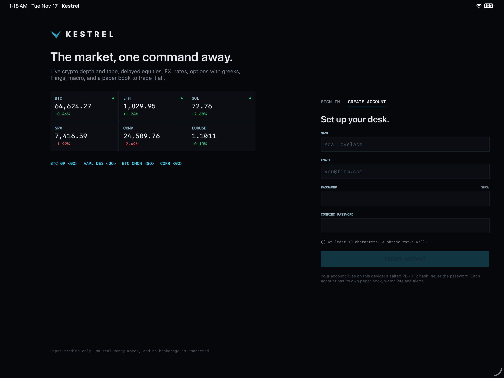
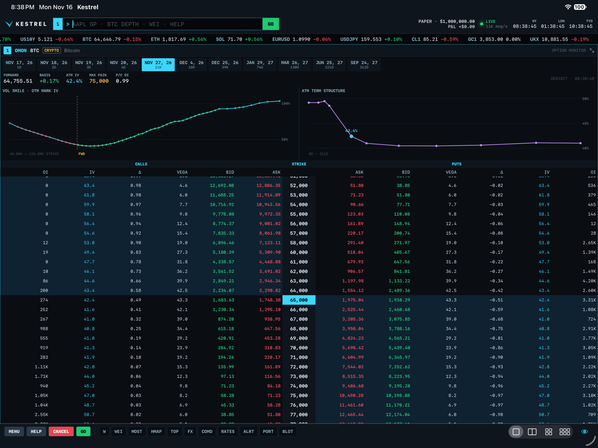
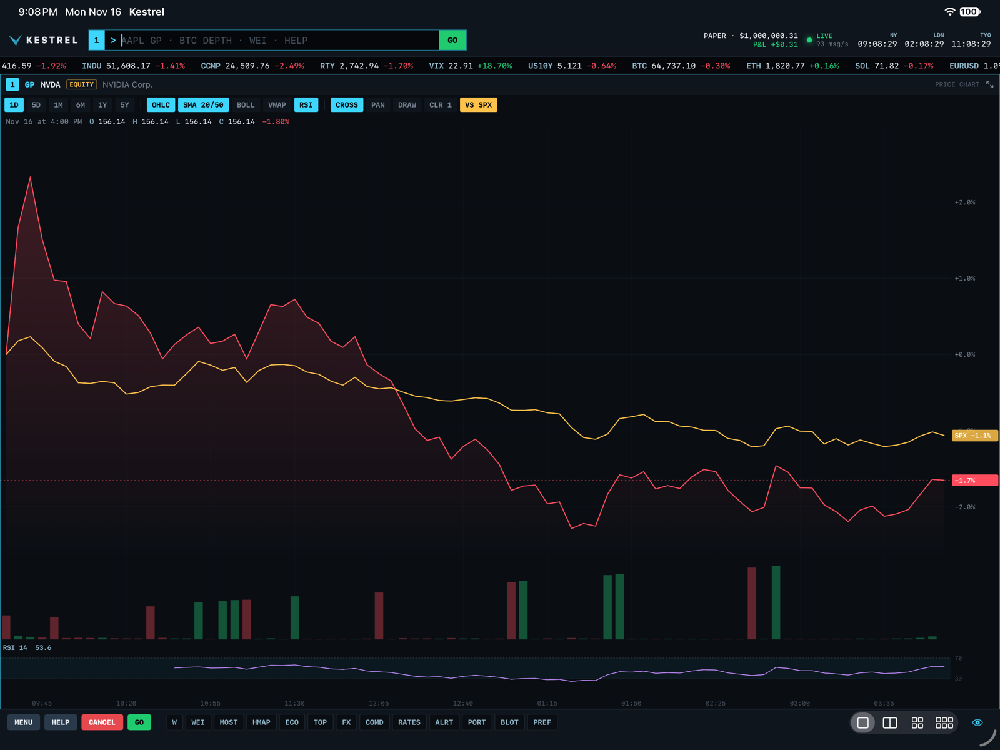
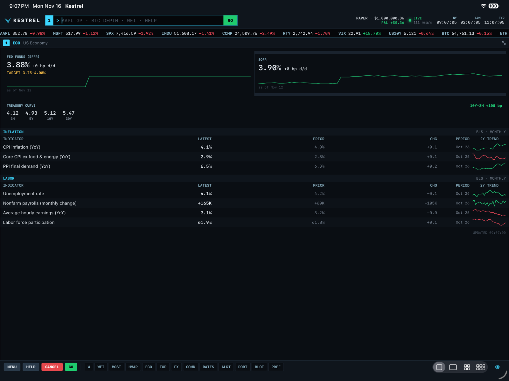
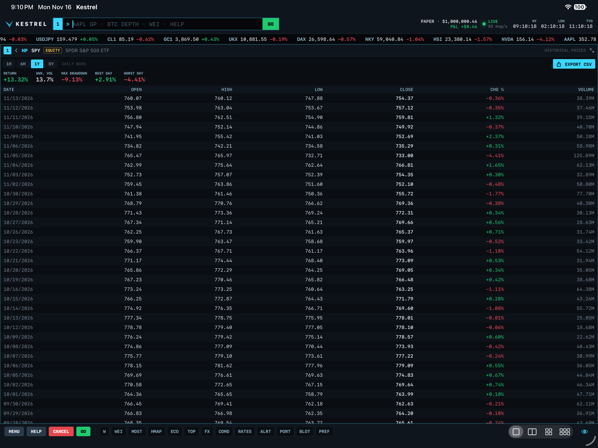

# Kestrel: a command-line market terminal for iPad and Mac

[](https://github.com/anamankev/kestrel/actions/workflows/ci.yml)

A native SwiftUI market terminal built around a command line: type `AAPL GP`, `BTC DEPTH` or `WEI`, press GO.
It uses live data from free public sources and has paper trading built in.



*Scripted tour, real app and live data. Re-record with `scripts/record-demo.sh <simulator-udid>` (launches with `-demo`).*



**Kestrel is subscription-only:** **$9.99 / month**, **$49.99 / 6 months** or **$99.99 / year**, with no free
tier or trial. Sign up or sign in first (the account holds your encrypted data and is tagged on the
purchase), then subscribe, then the terminal with everything included. A lapsed subscription returns to the subscribe page and keeps
the encrypted data, so resubscribing restores it. Purchases use StoreKit 2 with on-device verification. Test
locally with `Config/Kestrel.storekit` (selected in the scheme). Selling requires an Apple Developer Program
membership and the three products in App Store Connect: `dev.kestrel.pro.monthly`, `dev.kestrel.pro.halfyear`,
`dev.kestrel.pro.annual`. [Privacy policy](docs/PRIVACY.md).

Sign in or create an account on the first screen. Accounts stay on the device (salted PBKDF2), and each one has its own paper book, watchlists and alerts, encrypted with AES-256-GCM under a key only the password unlocks.



| Options monitor (`BTC OMON`) | Relative performance (`NVDA GP` VS SPX) |
|---|---|
|  |  |
| **US economy (`ECO`)** | **History and stats (`SPY HP`)** |
|  |  |

## Run
Open `Kestrel.xcodeproj` in Xcode 26+, pick an **iPad simulator** or **My Mac**, then press ⌘R.
Tests: `cd KestrelCore && swift test` (130 core tests) and `xcodebuild test -scheme Kestrel -destination 'platform=macOS'`
(20 app tests on Mac, 19+ on iPad: accounts, sessions, encryption at rest, StoreKit purchases, workspace routing, hotspots, pages, persistence regressions, formatting). CI runs both plus an iPad build
(`.github/workflows/ci.yml`).

## Functions
| Security | Markets | Trading |
|---|---|---|
| Any listed security: `7203.T`, `VOD.L`, `SAP.DE`, `0700.HK`, `GBPJPY`, `ES=F`, `^STI`. `DES` description (market cap, P/E) · `FA` 10-K financials · `EVTS` filings & earnings · `GP` chart (pan, trendlines, VS compare) · `HP` history + CSV · `BT` strategy backtest (SMA cross, RSI, Bollinger vs buy-and-hold; idle cash earns the 3-month T-bill; CAGR, excess-return Sharpe, Sortino, volatility, Calmar, drawdown, trades) · `DEPTH` L2 book · `TAS` time & sales · `OMON` options, smile & term structure (tap a contract to trade it) · `OSA` option strategies (straddles, spreads, condors, butterflies: payoff at expiry and today, greeks, breakevens) · `BETA` OLS regression on any benchmark (raw and Blume-adjusted beta, annualized alpha with t-stats, R², scatter, CSV) · `FACT` Fama-French factor regression (CAPM, FF3, Carhart 4, FF5: loadings, t-stats, annualized alpha) · `EVST` earnings event study (market model fitted before each 8-K release, other events excluded; AR, CAR and drift with cross-sectional t-stats) · `DVD` dividends (TTM yield, frequency, 5-year growth, every payment) · `CN` news | `SECF` security finder across every exchange (stocks, ETFs and funds worldwide, indices, any FX cross, futures, crypto; also `TOYOTA SECF`) · `W` editable watchlists · `WEI` world indices · `MOST` movers · `HMAP` heat map · `FX` · `COMD` · `RATES` · `ECO` US economy · `ECST` World Bank statistics for 217 countries: a 15-year profile (`ECST JAPAN`) or every country ranked on one indicator, full history since 1960 in CSV · `EQS` screener over every SEC filer's latest 10-K (revenue, earnings, margins, ROE, ROA, leverage; CSV) · `COMP` rebased total-return comparison (dividends reinvested; BETA and MVO use total returns too) with Sharpe and drawdown · `MVO` long-only efficient frontier, min-variance and max-Sharpe weights · `CORR` correlation matrix (cross-asset or your watchlist) · `ERN` earnings calendar for your watchlist (each company's own reporting cadence, ± spread) · `TOP` news with search (`"phrases"`, `-exclude`), source and time filters, and tappable tickers | `TRADE` ticket: market, limit, stop and stop-limit (`SOL BUY`, or BTC/ETH options, long premium only) · `PORT` P&L, risk (beta, VaR, ES, net delta), equity curve · `BLOT` orders & fills · `ALRT` price alerts (keep firing in the background: iPad background refresh, Mac menu bar) · `PREF` settings and encrypted iPad ↔ Mac transfer |

Type `n <GO>` to drill into numbered item n (list rows, DES functions). PAGES saves named layouts; each window (⌘N on Mac, Stage Manager on iPad) keeps its own panels.
Keys: ⌘1–⌘6 focus a panel, ⌘[ back, ⌘↩ maximize, ⌘L layout, ↑↓/Tab for autocomplete, Esc to cancel.
Tap a row to **link** that security into every security panel. Long-press a row for its functions.

## Architecture
```
KestrelCore (Swift package, no UI, fully tested)
  Universe        security master + ticker resolution
  CommandParser   TICKER [EXCH] [CLASS] FUNCTION grammar + autocomplete
  OrderBook       price-level L2 book: snapshot + deltas, ladder, imbalance
  PaperAccount    Decimal cash, signed positions (long/short, Reg T 150% short margin), market & limit orders, reservations, realized P&L
  Risk            beta, historical-simulation VaR / expected shortfall, date-aligned returns
  Indicators      SMA, EMA, Bollinger, Wilder RSI, VWAP
  Options         Black-76 greeks, implied-vol solver, chain analytics (ATM IV, max pain, P/C)
  Watchlists      named lists (add/remove/reorder) + AlertBook (above/below/move%, fire-once)
  Fundamentals    SEC XBRL company facts → 5-year 10-K series (tag fallbacks, restatements, margins, FCF)
  Macro           BLS batch decoder, YoY/change transforms, NY Fed rates, SEC filings timeline
  Decoders        Coinbase WS / REST, Yahoo chart, RSS (hardened)
Kestrel (SwiftUI app, iPadOS + macOS from one target)
  CoinbaseStream  actor: decodes ~100–200 msg/s off the main thread, coalesced to the UI at 10 Hz,
                  sequence-gap resync, backoff reconnect, stale-feed watchdog
  MarketStore     @Observable store; bounded-concurrency polling for delayed assets
  ChartView       single Canvas pass for candles, volume and studies (no per-candle views)
```

## Data (all free, no keys)
- **Crypto:** Coinbase Advanced Trade WebSocket, tick-by-tick, full L2 depth.
- **Equities, indices, FX, futures, rates:** Yahoo Finance chart endpoint (delayed snapshots).
- **Options:** Deribit public API (BTC, ETH), with greeks computed locally.
- **Fundamentals:** SEC EDGAR XBRL (needs a contact email set in PREF, as SEC requires).
- **Macro:** BLS public API (CPI, PPI, payrolls, unemployment, wages) and the New York Fed (EFFR, SOFR).
- **News:** CNBC, MarketWatch and CoinDesk RSS, plus Yahoo per-ticker headlines.

## Honest comparison with Bloomberg
Kestrel matches the terminal *workflow* (command line, linked panels, density, keyboard-first) and beats
Bloomberg's iPad app on touch and rendering. It does not have Bloomberg's data: there's no real-time
equity L2, fundamentals, fixed income or chat network, because those require paid exchange licences.

See [docs/PERFORMANCE.md](docs/PERFORMANCE.md) for measured latency and frame rate and the optimisations the benchmarks drove, [SECURITY.md](SECURITY.md) for the security review and [DESIGN_RESEARCH.md](DESIGN_RESEARCH.md) for the
design research.
