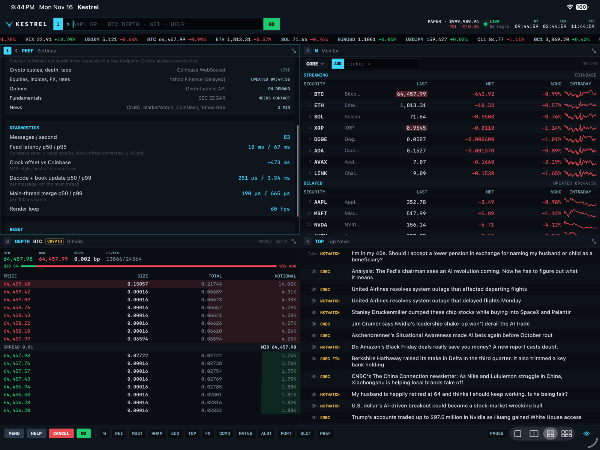

# Kestrel performance

How Kestrel keeps a live order book, a tick tape and three other panels smooth on an iPad, with measured
numbers. Every figure below is reproducible: the app numbers are in **PREF → Diagnostics**, and the
micro-benchmarks run with `KESTREL_BENCH=1 swift test -c release --filter Benchmarks` in `KestrelCore/`.

**Test machine:** Apple M5 MacBook Air (16 GB, fanless), iPad Pro 13" simulator, Release build. The machine
was under heavy memory pressure during measurement (≈17 GB of swap in use), so these numbers are pessimistic.

## Design in one picture

```
Coinbase WebSocket ──► CoinbaseStream (actor, off main)          MarketStore (@MainActor, @Observable)
  ~100–200 msg/s        decode JSON → apply to L2 books   ──10 Hz──►  merge one small diff  ──►  SwiftUI panels
                        sequence-gap check → resync                    quotes · books · tape        (Canvas charts,
                        stale watchdog (15 s) → reconnect                                            lazy tables)
Yahoo / Deribit / SEC ──► URLSession tasks; large JSON decoded in Task.detached, never on main
```

Three rules:

1. **Nothing heavy on the main thread.** WebSocket decoding and order-book maintenance run on an actor. Big
   payloads (SEC company facts at 3–8 MB, Deribit chains with about 1,000 contracts) decode in detached tasks.
2. **Coalesce, don't stream, into the UI.** Hundreds of book updates per second become one diff every 100 ms.
   SwiftUI sees at most 10 changes per second per book, whatever the feed rate.
3. **Draw charts in one Canvas pass.** Candles, volume, studies, trendlines and the crosshair are batched into
   a few paths per layer, never a view per candle.

## Live measurements (Release build, 4 panels: settings, monitor, BTC depth, news)



| Metric | p50 | p95 / p99 | Notes |
|---|---|---|---|
| Feed latency (Coinbase send → local receipt) | **10 ms** | 67 ms (p95) | Clock-offset corrected NTP-style (best of 5 round trips, ±40 ms). The raw clock offset was −473 ms, so uncorrected timestamps would have been meaningless. |
| Decode + book update per message (off main) | 293 µs | **2.2 ms** (p99, was 3.3 ms) | p99 is L2 snapshots (thousands of levels in one message). Single-pass decode since the last measurement. |
| Main-thread merge per 100 ms batch | **190 µs** | 665 µs (p99) | ≤ 0.7% of the main thread's time. |
| Render loop | **60 fps** | n/a | The simulator caps at 60 Hz. The same code targets 120 Hz ProMotion on device. |

## Micro-benchmarks (KestrelCore, release, median of 5–7 runs)

| Hot path | Time | Throughput |
|---|---|---|
| Coinbase L2 message decode (10 levels) | 13–17 µs | ~60–75k msg/s (feed is ~0.2k msg/s) |
| Order-book level update | 31–44 ns | ~25M updates/s |
| `ladder(depth: 20)` on a 20k-level book | **27–29 µs** (was 826 µs) | top-k selection |
| Black-76 price + delta/gamma/vega/theta | 27–32 ns | ~31M contracts/s |
| Implied-vol solve (safeguarded Newton) | 78–96 ns | ~11M solves/s |
| Deribit chain decode, 1,000 contracts | **2.8–3.0 ms** (was 44 ms) | |
| Chain analytics (ATM IV, max pain, P/C) per chain | 0.7–0.9 ms | |
| Historical VaR, 10 positions × 250 days | 42–58 µs | |
| SEC company-facts decode, 3–8 MB | 73–190 ms | off main thread |

## What the benchmarks caught

Measuring found three real problems, all now fixed and verified:

| Problem | Cause | Fix | Result |
|---|---|---|---|
| Depth panel spent ~0.8 ms per ladder build, several times per refresh | Sorted all ~20k price levels to show the top 20 | One-pass top-k insertion (O(n log k)) | **31× faster** (826 → 27 µs) |
| `OMON` froze the UI for ~44 ms every 15 s | A new `DateFormatter` per contract while parsing expiries | One shared formatter (mutex-guarded) plus a per-decode expiry cache | **15× faster** (44 → 3 ms) |
| Every WebSocket message was parsed twice | A small header decode for sequence and timestamp, then the full body | One envelope decode returns sequence, send time and events together | **43% cheaper** (119 → 67 µs/msg); live p99 3.3 → 2.2 ms |
| `FA` hitched the UI for 70–190 ms when it loaded | 3–8 MB SEC JSON decoded on the main actor | Decode in `Task.detached`; same for option chains | Main thread untouched |

## Correctness under load

- **Sequence gaps:** every Coinbase message carries a sequence number. A gap means a missed delta, so the book
  could be wrong. The stream drops the socket and resubscribes, and the fresh snapshot rebuilds every book.
- **Silent stalls:** if no message (including heartbeats) arrives for 15 s, the link shows STALE and reconnects.
  This was found in testing: a sleeping simulator left the socket open but dead while the UI still said LIVE.
- **Backoff:** reconnects back off exponentially from 0.5 s to 30 s.

## Known limits and next steps

- SEC company facts are decoded whole. A streaming parser that keeps only the ~15 tags we use would cut the
  70–190 ms decode and the memory spike.
- On-device profiling (Instruments, 120 Hz ProMotion, thermal behaviour on a real iPad) needs hardware. All
  numbers here are from the simulator on an M5.
